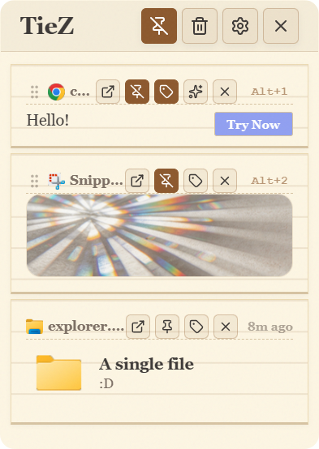

# TieZ · 界面定制版

<p align="center">
  
</p>

<p align="center">
  基于开源项目 <a href="https://github.com/jimuzhe/tiez-clipboard">jimuzhe/tiez-clipboard</a> 二次开发的剪贴板管理器<br/>
  重点重新构建了主界面视觉样式，保留原有核心功能
</p>

> **说明**：本项目是个人定制版本，不是 TieZ 官方项目。原项目版权归 LongDz 及上游贡献者所有，本项目遵循 GPL-3.0 协议。

## 项目简介

TieZ 是一款基于 Tauri 2 + React 构建的剪贴板管理工具，在本地记录剪贴板历史，支持文本、富文本、图片、文件和目录路径，并提供搜索、隐私脱敏、备忘录、云同步、局域网传输等效率功能。

本仓库在上游开源版本的基础上，重点重新设计了主界面的样式体系：把布局结构与主题视觉解耦，内置 5 套主题，支持浅色/深色模式，并让主窗口与紧凑预览窗口始终保持同一主题。

## 安装

### 下载安装包

前往 [Releases](https://github.com/iishen717/TieZ/releases) 下载最新安装包。当前版本为 **0.3.4**，文件名为：

```
TieZ_0.3.4_x64-setup.exe
```

双击运行安装程序，按向导完成安装即可。安装过程支持 English / 简体中文 / 繁體中文，默认安装到当前用户，无需管理员权限。

> 安装包未做代码签名，Windows 可能提示「Windows 已保护你的电脑」。点击「更多信息 → 仍要运行」即可继续安装。

### 系统要求

- Windows 10 / 11（x64）
- WebView2 Runtime（Windows 10/11 通常已内置）

## 从源码构建

如果你需要自行编译或修改代码，请先准备以下环境：

- Node.js 20.19+ 或 22.12+
- Rust（stable）与 Cargo
- Visual Studio Build Tools（C++ 桌面开发工作负载）
- WebView2 Runtime

安装依赖并启动开发模式：

```bash
npm install
npm run tauri:dev
```

构建安装包：

```bash
npm run tauri:build
```

生成的 NSIS 安装包位于：

```
src-tauri/target/release/bundle/nsis/
```

如需便携版：

```bash
npm run build:portable
```

产物位于 `artifacts/portable/tiez-portable.zip`。

> 首次构建需要编译 Rust 依赖，耗时较长；后续增量构建会快很多。

## 与上游版本的差异

- **主界面样式重构**：共享样式层只负责布局与组件结构，主题文件独立负责颜色、边框、圆角、阴影和材质效果
- **5 套内置主题**：3D 复古、便利贴、云母、毛玻璃、纸质书感
- **主题系统**：统一注册、自动加载，主题切换同步应用到主窗口和紧凑预览窗口
- **样式分层**：`src/styles/base.css` + `src/styles/components/*` + `src/styles/themes/*`
- **标签改造为备忘录**：顶部标签入口改为备忘录页面；剪贴板条目不显示标签图标和标签块，旧标签数据保留用于隐私检测
- 其余业务功能沿用上游实现

> 主题系统的设计思路、Token 约定和新增主题的方法见 [docs/THEME-SYSTEM.md](docs/THEME-SYSTEM.md)。

## 主题预览

<table>
  <tr>
    <td align="center"><b>3D 复古</b><br/></td>
    <td align="center"><b>便利贴</b><br/></td>
    <td align="center"><b>毛玻璃</b><br/></td>
    <td align="center"><b>纸质书感</b><br/></td>
  </tr>
</table>

此外还有「云母」主题，使用系统原生材质效果。各主题均提供浅色/深色两套配色，深色预览图见 `docs/images/*黑.png`。

## 功能特性

### 剪贴板管理

- 自动记录文本、富文本（HTML）、图片、文件与目录路径
- 支持置顶、Emoji 表情管理和全局搜索
- 虚拟列表渲染，历史记录较多时保持流畅
- 敏感信息预览自动脱敏（手机号、邮箱、身份证等）

### 效率操作

- 全局快捷键呼出，支持键盘导航和顺序粘贴模式
- 外部编辑器打开内容，保存后自动写回记录
- 可配置 AI 模型，对选中的剪贴板内容执行 AI 处理

### 备忘录

- 独立的多条备忘录，顶部下拉切换
- 标题与正文自动保存，底部显示保存时间
- 支持新建、清空正文、删除和导出 Markdown
- 备忘录只在备忘录页面显示，不进入剪贴板列表与搜索

### 同步与传输

- WebDAV 云同步
- MQTT 实时同步与验证码同步
- 局域网文件传输，支持扫码发送
- 多设备间同步剪贴板历史

### 界面体验

- 无边框透明窗口，支持贴边自动收纳、窗口置顶和紧凑预览
- 5 套主题与浅色/深色模式
- 简体中文 / English / 繁體中文

## 技术栈

- **桌面框架**：Tauri 2 + Rust
- **前端**：React 19 + TypeScript 5.8
- **构建**：Vite 7
- **主要依赖**：framer-motion、lucide-react、prismjs、react-virtuoso
- **测试**：Vitest + Playwright

## 目录结构

```
TieZ/
├── src/                    # React 前端
│   ├── features/           # 功能模块：app / clipboard / settings / memo / emoji / file-transfer
│   ├── shared/             # 公共组件、hooks、工具函数与类型
│   ├── styles/             # base.css、components、themes
│   └── locales.ts          # 中/英/繁三语文案
├── src-tauri/              # Rust 后端与 Tauri 配置
├── docs/                   # 主题系统文档与预览截图
├── public/                 # 静态资源
└── 项目运行教程.md          # 快速运行说明
```

## 开发与测试

仅调试前端界面：

```bash
npm run dev
```

运行测试：

```bash
npm test          # 单元测试（Vitest）
npm run test:e2e  # 端到端测试（Playwright）
```

## 注意事项

- 本定制版已移除自动更新功能，更新时请前往 Releases 手动下载新版安装包
- 定制内容与上游版本可能存在差异，合并上游更新前请先备份本地修改

## 许可证与致谢

- 本项目基于 [jimuzhe/tiez-clipboard](https://github.com/jimuzhe/tiez-clipboard) 二次开发，原项目作者为 LongDz
- 遵循 **GPL-3.0** 许可证，详见 [LICENSE](LICENSE)
- 如果你喜欢这个项目，欢迎前往上游仓库了解和支持原作者
- 本项目为个人定制版本，与上游官方无关
